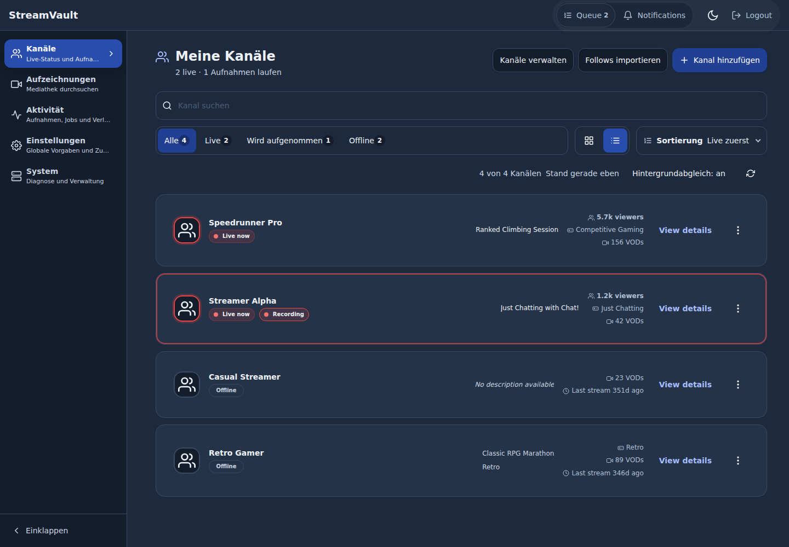
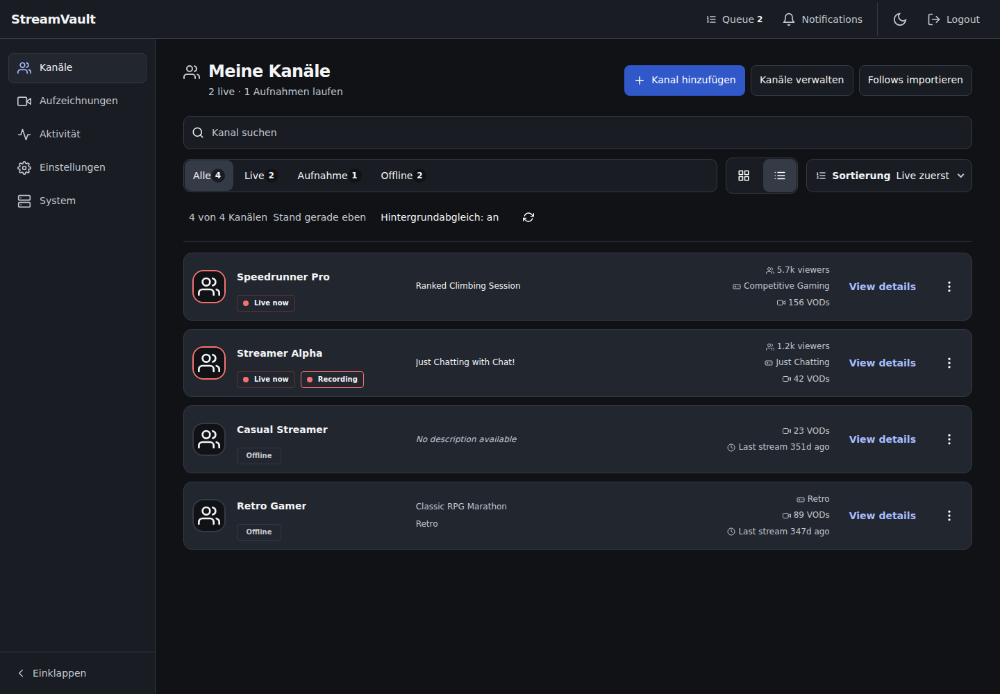
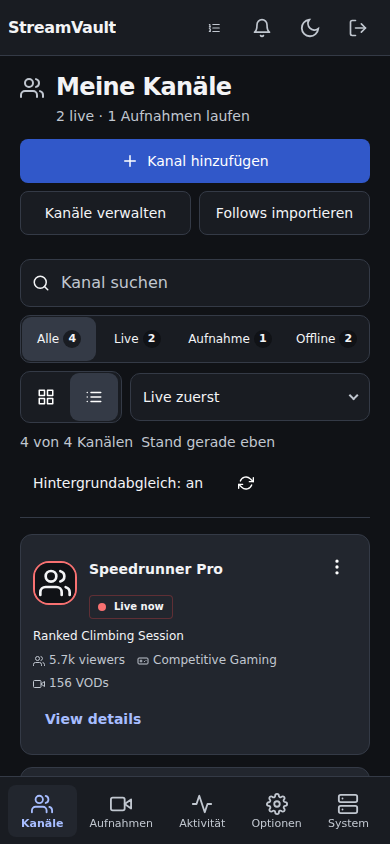
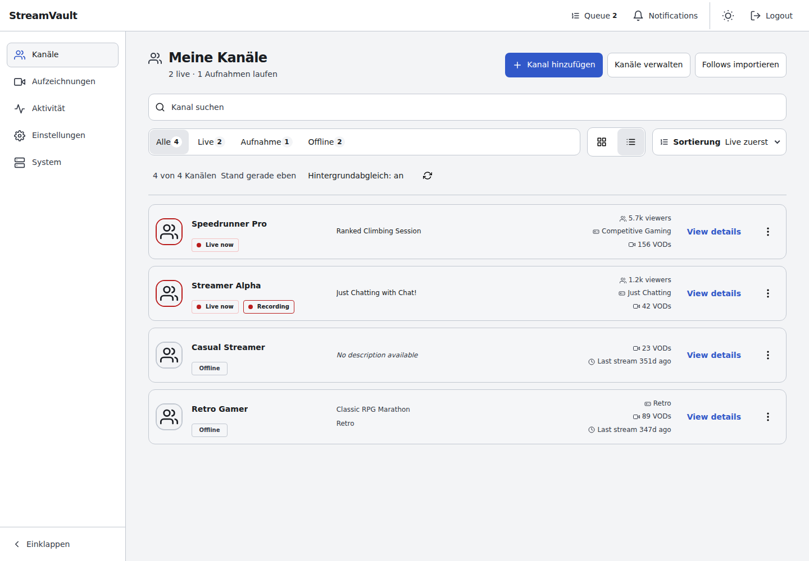
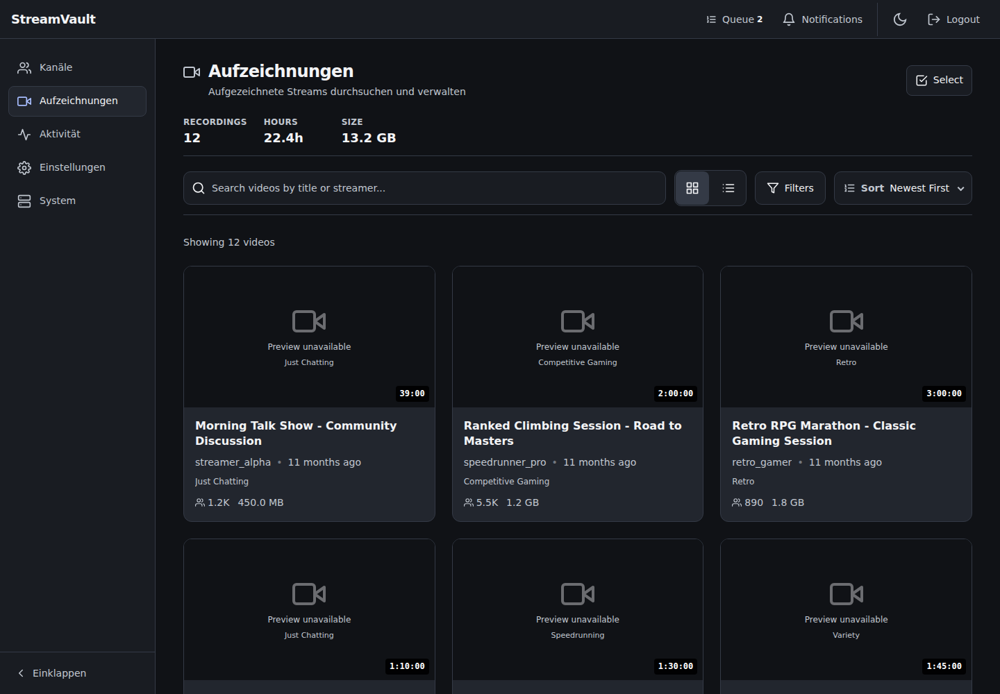

# UI consistency review — 1 November 2026

## Outcome and scope

The channel-first candidate in PR #969 now uses a consistent neutral visual system across its shell, channel browsing, recordings, overview/activity, channel details and global settings. This refines `f2b94e7973989b8702c3fc5b4af9c077e0397d4c`, based on develop `36e968774bb41b222296a75b3a406c0be385badd`.

The implementation retains Vue, TypeScript, Vite, Pinia, Vue Router and SCSS. No UI framework, runtime dependency, backend, deployment configuration or acceptance threshold was added or changed. The new channel-first work remains in its existing draft PR; develop changes only after a separate merge.

## Design decisions

- Neutral dark canvas and panels replace the blue-tinted stack of glass surfaces. Light mode uses the same semantic roles with neutral light surfaces.
- One token bridge and one shared button/field definition replace competing global definitions. Filled actions and colored text use separate contrast roles, including the inspected legacy consumers.
- Primary navigation uses one-line labels, restrained selection and consistent sidebar clearance. Header utilities remain reachable at 320px, with 48px targets. Mobile navigation gives longer labels the space they need.
- Channel rows are left aligned and compact: the representative desktop rows measure 98px high instead of 131px in the previous candidate. Status remains explicit; the entire recording card no longer pulses.
- Search, filters, list/grid switches and sorting follow a consistent toolbar layout. Mobile filters show complete labels/counts, and selected sort values retain their chevrons.
- Recordings keep their 16:9 media presentation. Overview summaries use dividers and plain sections; embedded Activity content has one page-level heading.
- Settings use a slimmer secondary navigation, shared page spacing and fewer enclosing panels. Section guidance remains visible on mobile, and the existing programmatic focus/retry behavior remains intact.

## Visual comparison

These are browser screenshots of the actual Vue application with synthetic repository data, not generated design mockups. External synthetic avatar URLs use the normal fallback; mock recordings have no thumbnail artwork. The settings capture includes its intentional programmatic focus outline.

### Channels before



### Channels after



| Mobile dark | Desktop light |
| --- | --- |
|  |  |

### Recordings and settings



[Mobile recordings](ui-consistency-2026-11-01/recordings-mobile-dark.png) · [Global recording settings](ui-consistency-2026-11-01/settings-desktop-dark.png)

## Review findings addressed

Independent source review identified three regressions during implementation: a global input selector overpowered search padding, changed foreground aliases reduced contrast on legacy filled controls, and a desktop flex basis became unwanted vertical space on mobile channel details. Each was corrected at its source and re-read by the reviewer.

Browser review additionally corrected narrow header wrapping, mobile navigation label fit and mobile library sort clipping. Existing settings retry tests caught the difference between `:focus-visible` and the required visible programmatic focus; the original `:focus` contract is retained. New browser regressions measure rendered geometry and text clearance rather than merely checking class names.

The final visual reference review inspected all 29 changed PNGs individually. Its one minor finding, a nearly invisible light-mode onboarding field boundary, was resolved by using the shared field background and border tokens. Both onboarding references were then re-inspected.

The active-filter contrast test still requires an explicit Axe pass, no violations or incomplete results, an opaque background and a manually calculated ratio of at least 4.5:1. It now verifies that Axe's returned selector resolves to the exact badge, instead of depending on Axe's choice of selector spelling after accessible labels changed.

## Verification

| Check | Result |
| --- | --- |
| Full frontend unit suite | 479 passed; 4 existing skips |
| Type checking | Passed |
| ESLint | 0 errors; 132 existing warnings, within the unchanged 167-warning gate |
| Token lint and generated foundation check | Passed; generated output current |
| Foundation browser suite | 5 passed, including both themes, 320–1440px, 200% text, focus/overlays, reduced motion and negative controls |
| REAL production frontend settings parity | 8 passed across 320/390/1024/1440px in light/dark; stateful synthetic HTTP fixtures |
| REAL settings loader | 16 passed; fresh/stale/unavailable assets, all sections, preserved drafts and cold deep links |
| Full MOCK desktop/mobile suite | 196 passed, 40 project-dependent skips, **16 failed on pre-existing external avatar console errors**, detailed below |
| New UI consistency browser cases | All 20 desktop/mobile project executions passed within the full MOCK suite |
| Targeted onboarding follow-up | 6 passed, 2 project-dependent skips |
| Visual references, comparison without update mode | 21 passed, covering all 29 PNG references after final visual review |
| Final layout/reference recheck after breakpoint consolidation | 41 passed, 21 project-dependent skips; covers the preceding visual and UI-consistency cases |
| Independent code and visual review | No remaining Critical, Important or Minor findings in the inspected changes/states |

The full MOCK run is **not represented as entirely green**. Its remaining 16 failures are the console-error assertions in `ui-standards.spec.ts` for `/`, `/overview`, `/streamers` and `/streamers/1`, in both themes and both Chromium projects. The failures contain `ERR_CERT_AUTHORITY_INVALID` from the synthetic `static-cdn.jtvnw.net/jtv_user_pictures/*-profile_image-300x300.png` requests. The same four failing URLs and console errors were independently reproduced on the unchanged candidate and the new build. The preceding contrast/target-size assertions pass. Console assertions, certificate validation and image requests were left intact; this local environment/fixture limitation is not hidden or converted into a passing result.

Existing UI gates retain their timeouts, contrast requirements, touch targets, negative controls and screenshot tolerances. The 29 visual references change because the requested palette and layout changed. They were individually reviewed and subsequently compared in ordinary assertion mode. Heading expectations now use the displayed title `Aufzeichnungen`; settings selectors use the shorter navigation labels. No expected functional state was removed.

The two compact-toolbar layouts use the existing `xs` breakpoint. Additional rendered text/geometry checks at 374px and 375px, for both browse pages in both themes, found no clipped filter labels/counts, sort text or chevrons and no page overflow.

### Builds and output budgets

Both REAL and MOCK production artifacts were built with the repository's provenance script. Existing output budgets and precache integrity checks pass without threshold changes. Application JavaScript figures below use the repository's existing separately accounted HLS-worker allowance.

| Artifact | Application JS bytes | Application JS gzip bytes | Precache entries |
| --- | ---: | ---: | ---: |
| REAL | 1,188,335 | 378,561 | 82 |
| MOCK | 1,191,484 | 379,441 | 81 |

### Reproduction

Use the locked frontend dependencies and the matching Playwright Chromium. The local review used Chromium 153.0.8010.12 through `PLAYWRIGHT_CHROMIUM_EXECUTABLE_PATH`; no browser or package dependency was changed in the repository.

```bash
npm run test:unit
npm run type-check
npm run lint:check
npm run lint:tokens
npm run check:foundation
npx playwright test --config tests/fixtures/settings-parity.config.ts
STREAMVAULT_SETTINGS_TEST_MODE=real npx playwright test --config tests/fixtures/settings-loader.config.ts
npx playwright test --project=desktop --project=mobile --workers=4
```

The local settings-loader run reused the byte-verified REAL artifact through a temporary test configuration with the same test file/projects/assertions. The foundation browser run likewise used a temporary configuration solely to select the matching browser executable. Repository configurations, build scripts and workflows remain unchanged. The preserved local logs also distinguish interim failures and their corrections from the final results above.

## Acceptance boundaries

REAL-mode frontend tests use synthetic, stateful HTTP fixtures. MOCK-mode tests use the repository's existing synthetic data. These checks cover frontend rendering and workflows; they do not claim new live Twitch OAuth, external recording-provider, physical-device, installed-PWA or production acceptance. The existing PWA/player/browser regressions remain part of the checked suite. No merge, release or deployment is included in this refinement.
